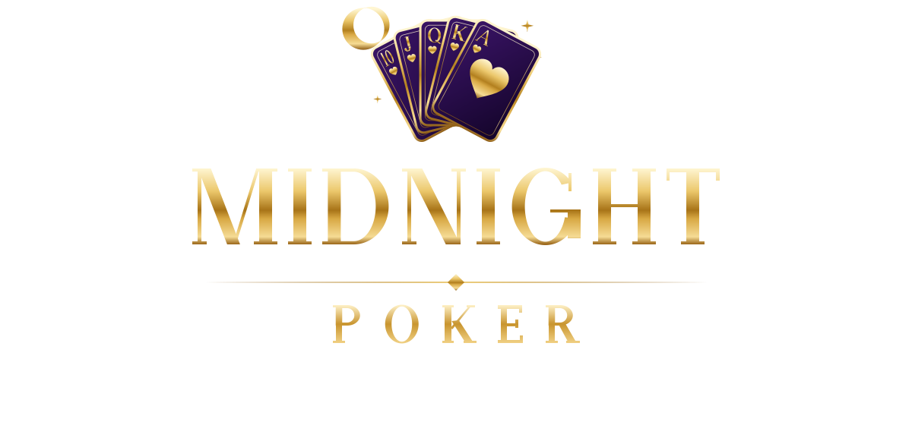
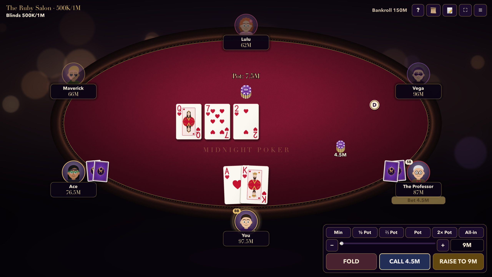
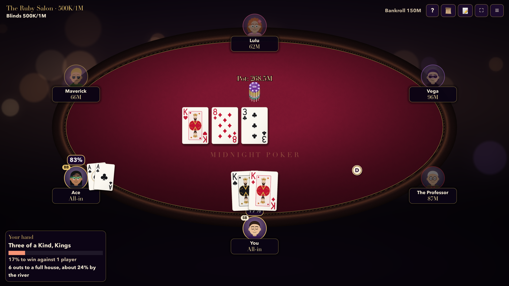
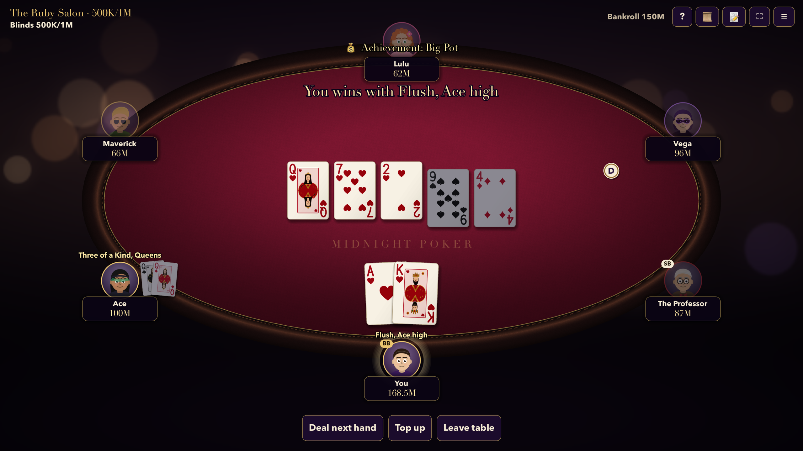
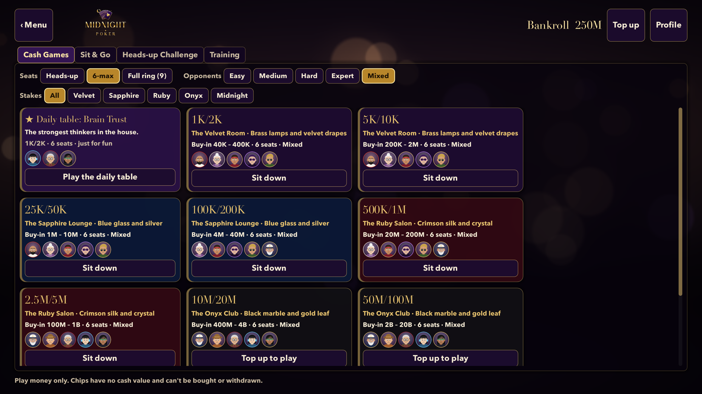
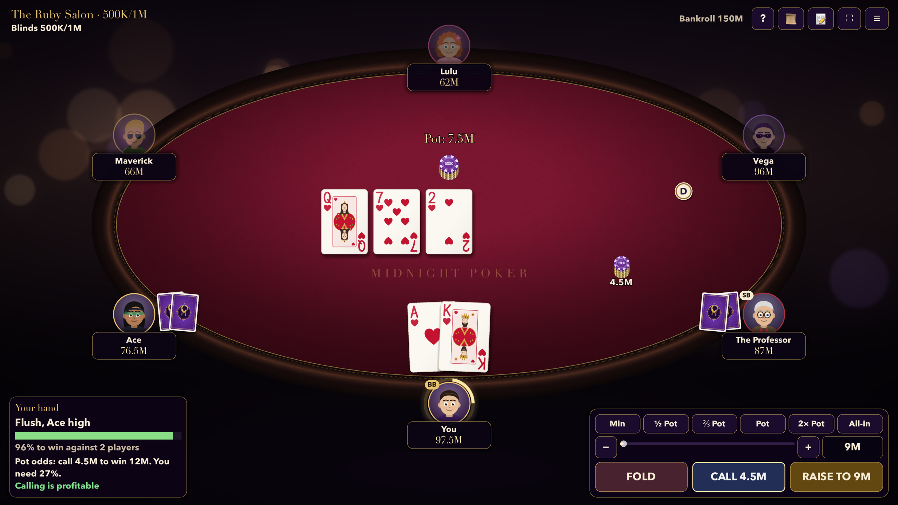

  

<b>Late-night Texas Hold'em against twelve characters with real personalities, for your Mac or PC. Play money only.</b>

## ⬇️ Download

[-c9952f?style=for-the-badge&logo=apple)](https://github.com/MilkshakeSR/MidnightPoker/releases/latest/download/MidnightPoker.dmg)
[-4b1c7a?style=for-the-badge&logo=windows)](https://github.com/MilkshakeSR/MidnightPoker/releases/latest/download/MidnightPoker-Windows.zip)

Or see every version on the [Releases page](https://github.com/MilkshakeSR/MidnightPoker/releases).

> **Play money only.** Chips have no cash value and can't be bought or withdrawn. No ads, no purchases, no online play, no gambling sites.

## Screenshots

## Features

- **Real No-Limit Texas Hold'em**: blinds and the dealer button (with proper heads-up rules), minimum raises, short all-ins that don't reopen the betting, main and side pots for any number of all-ins, showdown order and the odd-chip rule, all covered by automated tests.
- **Twelve opponents with personalities**: Rocky the tight boxer, Lulu who calls everything, the balanced Professor, Maverick the bluffer, Granny Rose the rock, Vega the trapper, Mei the mathematician, Captain Finn the unpredictable and more, up to **The Midnight Boss**, who studies your play and adapts. Each has an animated cartoon portrait, a bio, friendly chat and emotes, and Easy, Medium, Hard or Expert difficulty.
- **They play fair**: opponents only ever see their own cards and the table. They think about likely hands from your actions, pot odds, position and the board, never your cards or the deck.
- **Four ways to play**: cash games at nine stakes from 1K/2K to 250M/500M in five rooms; Sit & Go tournaments with rising blinds and prizes; the eight-opponent Heads-up Challenge; and the relaxed Training Table.
- **Learn as you go**: a hand strength meter, outs ("9 outs to a flush, about 35% by the river"), pot odds with a "profitable / not profitable" sign, a post-hand coach, opponent stats and notes, a hand-rankings card, a three-hand guided tutorial and a full hand history with step-by-step replays.
- **Big moments**: cards fly, flops flip one by one, all-ins get a spotlight and live winning percentages as the cards come, winning hands lift and glow, and royal flushes get a celebration all of their own.
- **Your bankroll**: start with 100K up to 1B, or Unlimited. Top up for free whenever you like. Chip stacks from 1K up to an iridescent 1B diamond chip.
- **Extras**: 37 achievements, detailed statistics with a results chart, a daily featured table, your own name and avatar.
- **Original everything**: cards, chips, portraits, sound effects and late-night jazz were all made for this game.
- **Comfortable**: fullscreen on any display from a 13" MacBook Air to ultrawide, keyboard and controller support, larger text, reduce motion, high-contrast cards, a 4-colour deck and colour-blind-friendly indicators.

## Requirements

- **Mac:** Apple Silicon (M1 or newer), macOS 11 Big Sur or later.
- **Windows:** Windows 10 or 11 (64-bit) with a graphics card that supports Vulkan or DirectX 12.

## Install

**Mac**
1. Open `MidnightPoker.dmg`.
2. Drag **MidnightPoker** into **Applications**.
3. The first time, right-click it in Applications and choose **Open**, then click **Open** again.
   (The app isn't notarized by Apple, so macOS asks you to confirm once.)

**Windows**
1. Unzip `MidnightPoker-Windows.zip` anywhere.
2. Run `MidnightPoker.exe`.
3. If SmartScreen warns you, click **More info** → **Run anyway**.

## Updates

Midnight Poker checks this page for a new version at most once a day (turn it off in **Settings → Updates**, or press **Check now**). When there's an update it shows what's new and a **Download update** button, but never in the middle of a hand. Download it and install it the same way as above; your game and settings are kept.

## Privacy

Everything stays on your computer. The only thing that goes online is the optional update check, which asks GitHub for the latest version number. No accounts, analytics or tracking.

## Play responsibly

If gambling ever stops being fun: [gamblinghelponline.org.au](https://www.gamblinghelponline.org.au)

## Report a problem

[Open an issue](https://github.com/MilkshakeSR/MidnightPoker/issues/new) and include your version (shown on the start screen and in Settings → Updates).

Version history: [Releases](https://github.com/MilkshakeSR/MidnightPoker/releases)

---

© 2026 Steven Robertson. All rights reserved. See [LICENSE.md](LICENSE.md).
